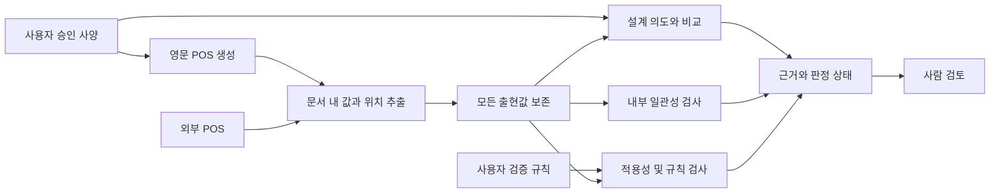

# spec-bridge 착수 리서치

조사일: 2026-09-30 · 대상: [프로젝트 계획서 v1](archive/spec-guard-project-plan-v1-2026-09-23.md), 2026-09-23 개정본

> **2026-10-05 계획 v2 재설계([D-001](decisions.md)) 이후 적용 범위**: 4장(규제·판본)과 6.3(Citation Guard)은 확장 과제 FR-14 자료로 보존한다. 6.1(관측값 구조)·6.2(근거 종류)·6.4(HITL 멱등성)·7장(16GB 스택)·8장(오프라인)·9장(평가 엄밀성)은 v2에도 그대로 적용한다. 대응표는 [과제 정합성 검토](spec-bridge-task-alignment-review.md) 6장 참고.

작업 ID: **W0-RESEARCH** — 공식 자료로 핵심 가정을 점검하고, 구현 전에 해결할 쟁점과 검증 실험을 정의한다.

이 문서는 조사 결과와 **설계 제안**이다. 기존 계획의 확정 사항을 변경하거나 W1 구현을 시작한 것은 아니다. 실행 순서는 [착수 체크리스트](spec-bridge-kickoff-checklist.md)에 정리했다.

## 1. 결론

**주기관 1종을 대상으로 근거를 추적할 수 있는 POS 생성·검증 도구를 만드는 방향은 타당하다. 첫 번째 투자 대상은 에이전트 구성보다 적용 규칙의 정확성, 추출 과정의 증거 보존, 독립적인 평가 데이터다.**

기존의 영문 POS, 로컬 우선, 결정론 검증, W4 MVP 종료선을 유지할 것을 제안한다. 단, 다음 사항은 착수 전에 정리해야 한다.

| 우선순위 | 발견 사항 | 필요한 조치 |
|---|---|---|
| P0 | M44 Rev.11의 발행일과 적용 시점이 다르다 | 선박 날짜와 별도로 엔진 형식승인 신청일 및 적용 판본을 관리 |
| P0 | NECA·스크러버 불리언만으로 적합성을 판단하면 오판 가능 | 해역·날짜·운전 모드·승인 증거와 `unknown` 상태를 포함 |
| P0 | 하나의 추출값으로 문서를 정규화하면 내부 불일치가 사라진다 | 문서 내 모든 값의 출현 위치를 보존 |
| P0 | 조항 ID 화이트리스트는 의미상 인용 정확성을 보장하지 않는다 | ID 유효성, 적용성, 주장 뒷받침 여부를 분리 |
| P0 | 합성 결함 주입기와 검증기의 논리 공유가 평가를 쉽게 만들 수 있다 | 독립 수기 사례, 정상 문서, 비적용 사례, 고정 테스트셋 추가 |
| P0 | `OFFLINE=1`은 앱 설정일 뿐 전체 프로세스의 무통신 증거가 아니다 | 모델 사전 준비, 텔레메트리 설정, 프로세스 밖 통신 관측 포함 |
| P1 | 16GB 동시 구동·5분 검증은 아직 실측 근거가 없다 | Qwen3-8B/4B와 임베딩 상주·순차 운용을 작은 실험으로 비교 |
| P1 | A~D에서 Citation Guard와 Impact를 함께 추가하면 효과를 분리하기 어렵다 | 검증 비교표와 변경 영향 비교표를 분리하는 수정안 검토 |
| P1 | 예산 0원과 필수 클라우드 8행 실험이 충돌한다 | 로컬 4행을 기본으로 하고 클라우드는 미실행 사유를 명시하는 수정안 검토 |

표의 설계 위험은 계획서에 대한 분석이다. 규정·도구 사실의 근거와 확인 한계는 아래에 각각 기록했다.

## 2. 조사 범위와 검증 상태

- 현재 작업 폴더에는 계획서만 있었으며 Git 저장소, 구현 코드, 테스트, 조항 레지스트리는 없었다.
- 계획서가 참조하는 `claude/specguard-research-and-uptime-review.md`, uptime/MRO 계획서 및 재사용 모듈은 현재 폴더에서 확인하지 못했다. 재사용 가능성·완료 여부는 **미확인**이다.
- 읽기 전용 환경 확인 결과는 `arm64`, 기본 `python3` 버전 `3.14.4`, `ollama`·`uv` 실행 파일 존재다. RAM 조회는 샌드박스에서 제한되어 16GB는 계획서의 전제로 사용했다. 모델 설치 상태·서버 상태·추론 속도는 측정하지 않았다.
- 조사에는 기관·제조사·라이브러리 공식 자료와 원 논문을 사용했다. 검색 결과의 게시일보다 문서 내부 판본·시행 조건을 우선했다.
- 계획서 H3에 따라, **웹에서 확인한 규정·엔진 정보도 사용자가 원문 발췌를 검토하고 `verified_by`를 채우기 전에는 `[미검증: 사용자 원문 대조 대기]` 상태**다. 아래 링크와 위치는 검토 후보이며 운영 레지스트리가 아니다.
- 이 문서의 M44, MARPOL 및 결의서 식별자는 출처 식별용이다. 현재 레지스트리가 없어 실행 가능한 조항 ID로 등록·승인된 것은 아니다. 규칙 상수나 실제 엔진 사양을 생성하지 않았다.

## 3. 산업 사례와 차별화

### 3.1 한화오션·Cohere 사례의 확인 범위

한화의 2026-01-27 공식 보도자료에서 한화오션·한화시스템·Cohere의 AI 협력 MOU와 설계·생산·운영 영역의 협력 의도를 확인했다. 이 자료만으로 POS PoC의 구체적 범위나 성과를 입증할 수는 없다. [한화 공식 발표](https://www.hanwha.com/newsroom/news/press-releases/hanwha-expands-industrial-alliance-with-canadian-companies-in-support-of-canadas-patrol-submarine-project.do)

계획서에 있는 ‘POS 생성·검증, 첫 대상 주기관’이라는 상세 설명은 이번 조사에서 이를 직접 뒷받침하는 기업 공식 발표 원문까지 확보하지 못했다. **[미검증]**으로 관리하고, 공개 README에는 공식 발표로 확인된 협력 사실과 독립 프로젝트의 자체 목표를 구분해 서술하는 것이 적절하다. PoC의 정확도·시간 절감·상용화 여부는 주장하지 않는다.

### 3.2 유사 도구: DNV RuleAgent

DNV RuleAgent의 공식 도움말은 자연어 규칙 검색, 판본·규칙 체계 선택, 규칙 참조가 달린 요약, 원문 확인 흐름을 안내한다. 따라서 ‘선급 규칙을 검색하고 인용한다’는 기능만으로 독창성을 주장하기는 어렵다. 공개 도움말에서 전체 기능이나 오프라인 지원 여부까지 판단할 수는 없다. [DNV RuleAgent](https://maritime.dnv.com/DocumentApprovalHelp/RuleAgent.html)

**설계 제안:** spec-bridge의 포트폴리오 가치는 다음 세 가지로 설명한다.

1. 구매사양서의 수치·단위·반복 기재를 결정론적으로 검증한다.
2. 승인된 입력 → POS 문장 → 근거 → 변경 승인 이력을 연결한다.
3. 로컬 환경에서 실패 사례까지 재현 가능한 평가를 제공한다.

이것은 경쟁 제품에 없는 기능이라는 주장이 아니라, 이번 MVP에서 직접 증명할 수 있는 가치다.

## 4. 도메인 조사: 계획서에서 먼저 보완할 사항

### 4.1 M44 Rev.11을 무조건 현재 기준으로 사용하지 않는다

**[미검증: 사용자 원문 대조 대기]** IACS 안내는 Rev.10 Corr.1과 Rev.11을 현재/향후 판본으로 구분한다. Rev.11 PDF의 **인쇄 p.2, 적용 주석 5**에는 **2027-01-01 이후 형식승인 신청 엔진**에 대한 적용 조건이 명시되어 있다. 프로젝트 개발일이나 선박 운항일만으로 판본을 고르면 안 된다. [IACS 판본 안내](https://iacs.org.uk/resolutions/unified-requirements/ur-m/ur-m44-rev9-corr2-cln), [ClassNK 제공 M44 Rev.11 원문](https://www.classnk.or.jp/hp/pdf/info_service/iacs_ur_and_ui/ur_m44_rev.11_apr_2025_cr.pdf)

**설계 제안:** `type_approval_application_date`, `rule_edition`, `applicability_basis`, `project_reference_date`를 구분한다. 기존 판본을 인용했다는 이유만으로 D5 결함을 부여하지 말고, **그 케이스에 적용되지 않는 판본을 인용했는지** 검사한다. 미래 프로젝트를 가정한 Rev.11 케이스도 가능하지만 날짜 가정을 명시해야 한다.

**[미검증: 사용자 원문 대조 대기]** Rev.11 **인쇄 p.3의 문서 제출 설명과 표 1~3**은 제출 목적·담당 주체·엔진 적용성을 구분한다. M44 전체 목록을 구매자에게 인도할 POS 제출도서 목록과 동일시하지 않는다. [M44 Rev.11 원문](https://www.classnk.or.jp/hp/pdf/info_service/iacs_ur_and_ui/ur_m44_rev.11_apr_2025_cr.pdf)

매핑 검토 시에는 ‘문서 이름 / 작성 주체 / 제출받는 주체 / 승인용·참고용 / 적용 엔진 / POS에서 요구할 근거’를 한 행으로 대조한다. 매핑이 미확정이면 ‘필수 누락’ 대신 ‘검토 필요’를 반환한다.

### 4.2 NECA 운항 → 특정 장치 필수라는 단축 규칙을 피한다

**[미검증: 사용자 원문 대조 대기]** IMO의 NOx 안내는 선박 건조 시점, 엔진 정격 회전수, 운항 해역, 개조·교체 상황을 구분한다. 최신 해역 개정까지 이 일반 안내 한 페이지만으로 확정할 수는 없다. [IMO NOx 안내](https://www.imo.org/en/ourwork/environment/pages/nitrogen-oxides-%28nox%29-%E2%80%93-regulation-13.aspx)

**[미검증: 사용자 원문 대조 대기]** MEPC.392(82), **PDF 3쪽(인쇄 p.2)**은 노르웨이해와 캐나다 북극 해역 관련 조건을 다르게 서술하며, 노르웨이해의 건조 기준에는 계약·용골·인도 날짜가 등장한다. **PDF 2쪽**에는 개정 발효일이 별도로 있다. 이는 날짜 필드를 하나의 불리언으로 대체하기 어렵다는 직접적인 사례다. [IMO 개정 원문](https://wwwcdn.imo.org/localresources/en/KnowledgeCentre/IndexofIMOResolutions/MEPCDocuments/MEPC.392%2882%29.pdf)

**설계 제안:** `voyage_areas[]`, `operation_date`, `building_contract_date`, `keel_laid_date`, `delivery_date`, `engine_installation_or_conversion` 및 `compliance_evidence`를 후보 필드로 검토한다. 값이 없으면 적용 여부를 `unknown`으로 둔다. 모든 해역을 구현할 필요는 없으며, MVP는 원문 검증된 해역과 날짜 범위만 지원하고 나머지는 범위 밖으로 표시한다.

계획서의 ‘NECA이면 EGR/SCR 명시’는 특정 설비의 존재와 배출 요구 충족을 혼동할 수 있다. Tier 적용 판단, 엔진 운전 모드, 인증·기술 자료의 증거를 나눠야 한다. 어떤 엔진에 어느 저감 장치가 필요한지는 **[미검증]**이며 해당 형식의 제조사 자료와 인증 자료로 확인해야 한다.

NOx 계산의 회전수도 이름이 비슷한 SMCR 필드로 자동 대체하지 않는다. **[미검증]** 인증 기준의 정격 회전수와 선택한 사양값의 관계를 원문으로 확인한다. 계산 테스트에는 판본별 구간 경계, 단위, 반올림, 적용 제외·정보 부족 사례를 포함하되, 규제 상수는 사용자 확인 레지스트리에서만 읽는다.

### 4.3 SOx·스크러버·연료 전환

**[미검증: 사용자 원문 대조 대기]** IMO 안내는 연료 황 함량의 질량 기준, 해역별 요구, 연료 전환 절차를 설명하며, IMO 2020 안내는 승인된 대체 수단인 배기가스 세정장치도 다룬다. ‘장치 있음’만으로 개별 선박의 적합성을 입증한 것으로 처리할 근거는 확보하지 않았다. [IMO SOx 안내](https://www.imo.org/en/ourwork/environment/pages/sulphur-oxides-%28sox%29-%E2%80%93-regulation-14.aspx), [IMO 2020 안내](https://www.imo.org/en/mediacentre/hottopics/pages/sulphur-2020.aspx)

**설계 제안:** 황 함량 값에는 질량 기준과 단위를 저장한다. 스크러버 불리언 외에 승인 증거·운전 모드·검토 범위를 두고, 확인되지 않은 예외는 자동 통과시키지 않는다. 항만별 운전 제한까지 구현하는 것은 이번 MVP 범위에 추가하지 않는다.

VLSFO → LNG 변경 시 연료 문자열만 바뀌는 시나리오는 충분하지 않다. 엔진 형식, 운전 모드, 연료 공급 인터페이스, 배출 증거, 관련 문서 항목에 미치는 영향을 검토한다. 실제 안전 설계 전체를 검증한다고 주장하지 않고 **프로젝트가 모델링한 POS 조항의 영향 분석**으로 범위를 명시한다.

### 4.4 프로젝트 가이드 값은 실측값·보증값이 아니다

**[미검증: 사용자 원문 대조 대기]** Everllence는 Project Guide를 초기 설계 단계의 예비 정보로 설명한다. 계획서 4-1의 ‘엔진 파라미터 실측값’이라는 표현은 ‘공개 가이드의 참고값’으로 수정할 것을 제안한다. 선정된 엔진의 계약 보증값으로 취급하지 않는다. [Everllence Project Guides](https://www.everllence.com/marine/products/planning-tools-and-downloads/project-guides)

첫 검토 후보는 **G80ME-C10.5-GI Project Guide, Edition 1.0, March 2026, 서문 인쇄 p.3**이다. 최신·최적 모델이라는 의미가 아니라 이번 세션에서 문서의 형식과 판본을 확인할 수 있었던 후보다. [공식 PDF](https://www.everllence.com/applications/projectguides/2stroke/content/printed/G80ME-C10_5-GI.pdf)

WinGD 후보는 **X62DF-S2.0 Marine Installation Manual, 2023-08 표기 문서**다. 최신판 여부와 선택할 엔진 형식의 적합성은 **[미검증]**이다. 처음에는 제조사 한 곳의 문서 한 종으로 표 추출과 근거 위치 보존을 검증한다. [WinGD 공식 PDF](https://my.wingd.com/media/jjndps0d/mim_wingd_x62df-s2-0_20230831.pdf)

**설계 제안:** 엔진 수치마다 운전 모드·부하점·기준 조건·단위·참고값/가정값/보증값 구분을 둔다. SFOC 하나로 서로 다른 연료 모드의 모든 소비 성능을 표현할 수 있다고 가정하지 않는다. 필요한 성능 항목은 사용자 제공 가이드 발췌를 받은 뒤 확정한다.

## 5. 코퍼스 확보와 근거 관리

### 5.1 확보 경로

다음은 다운로드 완료 목록이 아니라 원문 검토를 시작할 수 있는 출처 목록이다.

| 자료 | 이번 확인 상태 | 첫 검토 위치·용도 |
|---|---|---|
| [M44 Rev.10 Corr.1](https://www.classnk.or.jp/hp/pdf/info_service/iacs_ur_and_ui/ur_m44_rev.10_corr.1_feb_2022ul.pdf) | 공식 회원 선급 제공 PDF 접근 확인 | 첫 페이지 적용 주석, 도서 제출 목적과 목록 |
| [M44 Rev.11](https://www.classnk.or.jp/hp/pdf/info_service/iacs_ur_and_ui/ur_m44_rev.11_apr_2025_cr.pdf) | PDF 접근·적용 주석 확인 | 인쇄 p.2 적용 시점, p.3 및 표 1~3 |
| [IMO NOx](https://www.imo.org/en/ourwork/environment/pages/nitrogen-oxides-%28nox%29-%E2%80%93-regulation-13.aspx)·[SOx](https://www.imo.org/en/ourwork/environment/pages/sulphur-oxides-%28sox%29-%E2%80%93-regulation-14.aspx) | 공식 설명 페이지 확인 | 학습용 안내; 전체 통합 협약 원문을 대신하지 않음 |
| [IMO 개정 결의 목록](https://www.imo.org/en/ourwork/environment/pages/index-of-mepc-resolutions-and-guidelines-related-to-marpol-annex-vi.aspx) | 접근 확인 | 기준 판본 이후 개정의 발효·적용 여부 대조 |
| [KR-RULES 2026](https://www.krs.co.kr/KRRules/KRRules2026/KRRulesK.html) | 공식 포털 및 기관장치 제5편 경로 확인 | 선택할 편·장·절과 개정 회보 확인; 개별 조항 미검증 |
| [DNV Rules and Standards](https://www.dnv.com/rules-standards/) | 공식 접근 경로 확인 | 판본·규칙 체계 선택; 대상 조항 및 재사용 조건 미검증 |
| [Everllence Project Guides](https://www.everllence.com/marine/products/planning-tools-and-downloads/project-guides) | 공식 목록·후보 PDF 확인 | 서문, 엔진 선정, 성능 조건, 공급 인터페이스 |
| [WinGD MIM 후보](https://my.wingd.com/media/jjndps0d/mim_wingd_x62df-s2-0_20230831.pdf) | 공식 PDF 경로 확인 | 형식명·판본·목차부터 대조 |

### 5.2 수집 절차 제안

1. 사용자와 첫 케이스의 날짜·해역·엔진 형식을 고른다.
2. 해당 원문 발췌에 문서명·판본·인쇄 페이지·PDF 페이지·표/주석 위치를 붙인다.
3. 출처 후보를 검토하고 사용자가 확인한 항목만 운영 레지스트리에 승격한다.
4. 원문 파일의 해시와 취득일, 파서 버전·옵션을 기록한다. 개정 시 기존 판본을 덮어쓰지 않는다.
5. 검색용 청크는 조항 본문뿐 아니라 적용 조건·표 머리글·각주를 연결한다. 원문 위치는 구조화 데이터로 보존한다.

필드 제안: 기존 `source`, `edition`, `location`, `verified_by`에 `source_url`, `retrieved_at`, `source_sha256`, `pdf_page`, `printed_page`, `effective_from`, `applicability_basis`, `verification_status`를 추가 검토한다. `verified_by`는 사용자만 작성한다. 이는 스키마 제안이며 실제 레지스트리 항목을 만든 것이 아니다.

PDF 문서를 커밋하지 않는다는 원칙만으로 모든 파생 자료의 공개 권한이 확인되지는 않는다. 출처별 재사용 조건을 확인하기 전에는 공개 가능 상태를 ‘미확인’으로 두고, 공개 샘플에는 자체 작성 합성 내용과 출처 링크를 우선 사용한다. 원문 표·도표의 대량 재배포나 로그인 제한 우회는 수집 계획에 포함하지 않는다.

## 6. 아키텍처 보완 제안

### 6.1 설계 의도와 문서 관측값을 구분한다

현재 ‘스키마가 진실원천’이라는 원칙은 생성에는 적합하지만, 외부 POS 검증에서 확인된 설계 원본이 없는 경우도 정의해야 한다.

**설계 제안:** 자료를 `DesignSpec`(승인 입력), `ObservedFact`(원문 위치별 추출값), `Finding`(판정), `EvidenceRef`(근거 참조)로 나눈다. 같은 출력 값이 세 곳에 나타나면 세 관측값을 보존한다. 정상값 하나로 덮어쓰거나 다수결로 확정하지 않는다.

외부 문서에 승인 입력이 없으면 내부 일관성·적용 규칙 위주로 검사하고 ‘설계 의도와 일치’는 평가하지 않는다. 판정 상태는 `pass / fail / unknown / not_applicable`로 구분한다. 값 없음·파싱 실패·근거 없음이 `pass`로 바뀌지 않게 한다.

### 6.2 모든 결함의 근거가 외부 규제 조항일 필요는 없다

섹션 간 SMCR 불일치의 직접 증거는 서로 다른 두 문서 위치다. 여기에 외부 규제 조항을 억지로 연결하면 인용 품질을 오히려 해칠 수 있다.

**변경 제안:** `evidence_refs`의 종류를 규정 조항, 승인 입력, 문서 내 관측값, 프로젝트 작성 규칙으로 구분한다. 외부 규정 위반에는 검증된 규정 조항을 필수로 하고, 내부 불일치에는 관측값 두 개와 내부 검사 규칙을 필수로 한다. 이 수정은 원 계획의 ‘모든 결함에 근거 조항 ID’ 정의를 바꾸므로 구현 전 결정 사항이다.

### 6.3 Citation Guard의 책임을 좁고 정확하게 정의한다

등록된 ID를 사용했어도 판본·적용 조건이 틀리거나, 조항이 주장과 관계없을 수 있다. ALCE 연구도 답변의 정확성과 인용 품질을 별도 평가 대상으로 다룬다. [ALCE 원 논문](https://aclanthology.org/2023.emnlp-main.398/)

**검증 단계 제안:**

| 단계 | 검사 | 자동화 수준 |
|---|---|---|
| 1 | 해당 실행에서 허용한 근거 ID인가 | 결정론 |
| 2 | 사용자 확인 상태·판본·위치·원문 해시가 유효한가 | 결정론 |
| 3 | 해당 케이스에 적용되는가 | 검증된 조건식; 정보 부족은 보류 |
| 4 | 그 근거가 실제 판정을 뒷받침하는가 | 사람 검토 중심; LLM 평가는 보조 |

레지스트리 전체에 존재하는지만 확인하지 말고, 해당 판정에 제공된 증거 집합 안에 있는지도 확인한다. 조항 제목·페이지는 LLM이 작성한 문자열을 그대로 출력하지 말고 레지스트리에서 렌더링한다.

G2는 ‘미등록 ID가 최종 출력에 남은 건수’, ‘의미상 인용 정확도’, ‘근거가 필요한 주장 중 근거가 붙은 비율’, ‘기각·보류 건수’를 함께 보고하도록 구체화할 것을 제안한다. 출력이 없으면 미등록 ID 0건이더라도 인용 정확도는 100%가 아닌 N/A다.

### 6.4 변경 영향과 승인

파라미터 → 계산값 → 요구사항 → POS 조항의 의존성을 저장하고, 변경 전·후 적용 조건의 합집합을 검사한다. 새로 필요한 조항뿐 아니라 더 이상 적용되지 않아 삭제·검토해야 하는 조항도 영향 집합에 들어간다. 자연어 변경 요청은 승인할 구조화 diff로 먼저 변환한다.

LangGraph 공식 문서에 따르면 interrupt 재개 시 해당 노드가 처음부터 다시 실행될 수 있다. 따라서 승인 전후의 저장·로그 쓰기가 중복되지 않도록 설계해야 한다. [LangGraph interrupts](https://docs.langchain.com/oss/python/langgraph/interrupts)

**설계 제안:** `thread_id`, 기준 문서 버전, patch ID를 연결하고, 승인 대상 버전이 이미 바뀌었으면 재검토한다. 한 번 승인한 patch의 중복 반영, 재개 후 로그 중복, 일부 승인·일부 기각을 검증한다. 체크포인트와 감사 로그는 역할을 구분한다.

### 6.5 입력·출력 문서 지원 범위

python-docx 문서는 수정 추적 요소 안의 문단이 일반 `paragraphs` 목록에 나타나지 않을 수 있다고 명시한다. 수정 추적이 있는 DOCX를 단순 추출하면 내용을 빠뜨릴 위험이 있다. [python-docx Document API](https://python-docx.readthedocs.io/en/latest/api/document.html)

**설계 제안:** W4 출력은 일반 DOCX와 별도 추적성 표로 정의하고, W5 redline은 UI/리포트의 조항별 변경 전후 표시로 시작한다. Word의 네이티브 Track Changes와 동일한 기능으로 약속하지 않는다. 입력 DOCX의 미해결 수정 추적, 스캔 PDF, 중첩 표 등은 지원 여부를 명시한다. 추출하지 못한 구간을 누락 없이 통과한 문서처럼 보고하지 않는다.

## 7. 16GB 로컬 스택 검토

### 7.1 유지할 구성과 검증할 구성

| 구성 | 조사 결과 | 착수 제안 |
|---|---|---|
| Qwen3-8B / Ollama | 모델 페이지는 Q4_K_M, 파일 약 5.2GB로 표시 | 기본 후보 유지. 파일 크기를 실제 RAM 사용량으로 해석하지 않음 |
| Qwen3-4B | 계획서가 정한 경량 대안 | 8B 실패 시 동일 입력으로 비교 |
| BGE-M3 | 모델 카드에 다국어, 1024차원, 최대 8192 토큰 및 여러 검색 방식 명시 | 영문·한국어 교차 검색 후보 유지. 한국어 선급 문서 성능은 별도 측정 |
| Docling | 모델 사전 다운로드 및 로컬 artifacts 경로 지원 | 파싱 시 LLM을 내리고 결과 캐시 |
| SQLite / Chroma | 로컬 저장·검색 구성을 만들 수 있음 | SQLite를 권위 데이터로, 검색 인덱스를 재생성 가능 데이터로 취급 |
| LangGraph | 상태 보존·사람 승인 흐름 지원 | W5 통합 순서 유지. 순수 검증 함수를 그래프 밖에서 먼저 검증 |
| FastAPI / Streamlit | 기존 계획 선택 | 도메인 로직을 UI와 분리. W4·W5 순서 유지 |

근거: [Qwen3-8B 모델 페이지](https://ollama.com/library/qwen3:8b), [BGE-M3 모델 카드](https://huggingface.co/BAAI/bge-m3), [Docling advanced options](https://docling-project.github.io/docling/usage/advanced_options/), [Chroma 로컬 클라이언트](https://docs.trychroma.com/reference/python), [LangGraph interrupts](https://docs.langchain.com/oss/python/langgraph/interrupts)

**측정 가설:** Qwen3-8B Q4 + BGE-M3 + 앱은 16GB에서 시험할 만하지만, KV 캐시·배치·컨텍스트·OS·IDE 사용량을 포함한 실제 적합성은 미확인이다. 계획서의 ‘BGE-M3 약 2GB’도 프로세스 전체 메모리로 확정하지 않는다.

첫 실험은 단일 요청, 4K 컨텍스트, 리랭커 제외로 시작하고 필요할 때 8K를 비교한다. 모델 digest, 양자화, Ollama 버전, 입력/출력 길이를 기록한다. Ollama는 컨텍스트 설정과 모델 상주 시간을 제어할 수 있으며 컨텍스트 증가에 따른 메모리 부담을 안내한다. [Ollama FAQ](https://docs.ollama.com/faq), [Context length](https://docs.ollama.com/context-length)

구조화 추출은 JSON Schema를 전달한 후 별도로 파싱·검증한다. Ollama는 schema 기반 출력을 지원하지만 이것이 추출값의 사실성을 검증해 주는 것은 아니다. [Structured outputs](https://docs.ollama.com/capabilities/structured-outputs)

추론 모드는 고정해 기록한다. 속도 측정 시 해당 설치 버전·모델이 허용하면 `think=false`부터 비교하고, 사고 출력과 최종 답변을 혼동하지 않는다. [Ollama thinking](https://docs.ollama.com/capabilities/thinking)

macOS의 Docker Desktop에서는 Ollama GPU 가속을 사용할 수 없다는 공식 설명이 있으므로, Apple Silicon 성능 측정은 호스트 Ollama를 기준으로 한다. W6 Compose는 앱 배포와 연결 방법을 문서화하고 macOS 전체 컨테이너 실행을 같은 성능 경로로 취급하지 않는다. [Ollama FAQ](https://docs.ollama.com/faq)

기본 Python이 3.14.4라는 사실만으로 전체 스택의 호환성을 가정하지 않는다. 구현 전 별도 프로젝트 환경에서 의존성 해결·import smoke test를 수행하고 Python 버전과 lockfile을 고정한다. 이번에는 패키지를 설치하지 않았다.

### 7.2 하이브리드 검색의 구체적 의미

**설계 제안:** 조항·판본·형식명 정확 일치 + 키워드 검색 + BGE-M3 dense 검색을 결합하고, 순위 결합 후 적용 판본을 다시 검사한다. 첫 구현에서 BGE-M3의 dense·sparse·multi-vector를 모두 운영할 필요는 없다.

SQLite FTS5는 기본 unicode61과 trigram 등의 토크나이저를 제공한다. 이것만으로 한국어 형태소 분석이 구현되는 것은 아니다. [SQLite FTS5](https://www.sqlite.org/fts5.html)

30개 조항에서는 복잡한 검색 시스템의 우월성을 주장하기보다, 정확 ID 조회·키워드 기준선과 비교해 다국어 의미 검색이 실제로 개선하는 질의를 찾는다. 분리하면 의미를 잃는 표 행·단위·각주는 함께 검색 결과에 제공한다.

## 8. 오프라인 검증 설계

G4의 ‘외부 호출 0회’는 **특정 버전·실행 경로·관측 구간에서의 측정 결과**로 정의해야 한다. 루프백의 Ollama HTTP 호출은 허용하되 외부 주소의 HTTP·DNS·텔레메트리·모델 다운로드를 관측 범위에 포함한다.

| 지점 | 공식 자료에서 확인한 사실 | 필요한 설정·확인 |
|---|---|---|
| Ollama | `OLLAMA_NO_CLOUD=1`로 클라우드 기능 비활성화 가능 | 로컬 모델·주소 제한; 별도 프로세스의 통신도 관측 |
| Docling | 사전 취득한 모델 경로 지정, 원격 서비스 opt-in 지원 | artifacts·OCR 언어팩 준비, remote services 비활성화 |
| Chroma | 공식 소스의 설정에 `anonymized_telemetry` 항목 존재 | 설치 버전에서 비활성화와 실제 동작 확인 |
| Streamlit | `browser.gatherUsageStats` 설정 제공 | 통계 전송 비활성화, 브라우저 외부 리소스도 확인 |

근거: [Ollama FAQ](https://docs.ollama.com/faq), [Docling advanced options](https://docling-project.github.io/docling/usage/advanced_options/), [Chroma 공식 설정 소스](https://github.com/chroma-core/chroma/blob/main/chromadb/config.py), [Streamlit config](https://docs.streamlit.io/develop/api-reference/configuration/config.toml)

**시험 제안:**

1. 온라인 준비 단계에서 의존성·모델·문서를 확보하고 manifest를 저장한다.
2. 앱 단위 검사에서 외부 provider 생성, URL 기반 문서 취득, 원격 fallback을 차단한다.
3. 통합 시험에서 앱·Ollama·임베딩·UI를 포함한 프로세스의 비루프백 통신을 차단·관측한다. Python HTTP mocking만으로 G4 통과를 선언하지 않는다.
4. 모델이 준비된 상태와 필수 artifact가 빠진 상태를 각각 실행한다. 후자는 네트워크로 복구하지 않고 누락 원인을 보고해야 한다.
5. 정상 실행과 에러·재시도·재개·DOCX 내보내기 경로를 함께 검사한다. 관측 장치가 실제 시도를 잡는지 별도 테스트로 먼저 확인한다.

통신 **성공 건수**, **시도 건수**, **차단 건수**를 구분한다. 시도가 있었지만 차단된 실행을 ‘호출 시도 0회’로 보고하지 않는다. 이번 조사에서 G4 시험은 실행하지 않았다.

## 9. 평가 설계 검토

### 9.1 결함 정의와 데이터 분리

계획의 D1과 D2는 한도 위반에서 겹칠 수 있고 D4와 D1도 요구사항 누락에서 겹친다. D6은 결함의 관측 형태보다 변경 이력의 원인에 가깝다.

**설계 제안:** 하나의 발견 사항에는 대표 유형을 고정하고 부가 원인을 별도 태그로 둔다. 예를 들어 계산 한도 초과는 D2, 필수 항목 부재는 D4, 섹션 간 값 차이는 D3로 분류하는 기준을 문서화한다. D6 집계는 변경 시나리오 평가에서 별도로 수행한다. 기존 유형 정의 변경은 CP-S2 전에 검토해야 한다.

40건의 변형을 무작위로 나누면 같은 원본·문장·주입 패턴이 개발셋과 테스트셋에 걸칠 수 있다. 원본 케이스·템플릿·주입 패턴 계열을 기준으로 분리하고, 가능하면 한 케이스 계열을 최종 평가용으로 보류한다. 케이스가 4개뿐이므로 결과를 실제 선박 POS 전체에 일반화하지 않는다.

평가자는 주입기의 정답 파일을 읽을 수 있지만 검출기·검색 질의·프롬프트에는 전달하지 않는다. 합성 파일명·주석·문장에 결함 유형이 노출되지 않도록 한다. 별도로 사람이 작성한 독립 사례, 정상 문서, 비적용 사례, 단위만 다른 동등값, 근거 부족 사례를 포함한다.

### 9.2 판정 매칭과 지표

`document_id + clause_id + defect_type` 등을 사용해 예측과 정답을 일대일로 매칭한다. 중복 발견으로 TP가 늘어나지 않게 하고, 위치 오차·복수 유형 허용 정책을 평가 전에 고정한다.

| 지표 | 권장 정의·추가 보고 |
|---|---|
| G1 결정론 재현율 | D1~D3별 TP/(TP+FN), micro/macro 및 분모 공개 |
| 정밀도 | 유형별 TP/(TP+FP), 정상 문서당 FP 수 병기 |
| 추출 정확도 | 필드값·단위·위치 정확도 및 모든 출현값 회수율 |
| G2 미등록 인용 | 최종 출력과 기각 전 원시 출력 각각 집계 |
| G2 의미상 정확도 | 사람이 근거·판정 쌍을 읽어 판정; 불확실 라벨 유지 |
| 인용 coverage | 근거가 필요한 주장 중 유효 근거가 있는 비율 |
| 보류 | `unknown`·기각률과 원인; 출력이 줄어든 이유 공개 |
| G3 변경 영향 | 독립적으로 작성한 정답 집합에 대한 P/R, 추가·삭제 영향 포함 |
| 생성 품질 | 자가 검증 결과에 더해 입력 충실도·근거 뒷받침·사람 검토 |
| NFR-04 성능 | 문서 크기, 재시도 포함 wall time, cold/warm 구분, 중앙값·범위·실패 수 |

정답 스키마를 검증기에 직접 넣는 실험은 검증기 성능이다. 문서 → 추출 → 검증을 모두 거치는 end-to-end 결과와 따로 보고해야 한다. 추출 실패를 제외한 결과만으로 G1을 달성했다고 하지 않는다.

‘생성기와 같은 검증기로 다시 검사해 결함 0건’은 독립적인 품질 증거가 아니다. 수정된 문장이 입력 사양을 바꾸지 않았는지도 확인한다.

단위 검사에서는 ‘단위 혼용’과 ‘차원이 다름·변환 오류’를 구분한다. 서로 변환 가능한 단위로 같은 값을 정확히 병기한 문서는 수치 오류가 아닐 수 있다. 영문 POS를 kW로 통일하는 것은 프로젝트의 작성 정책으로 표시하고, 실제 규정 위반과 다른 근거·심각도로 처리하도록 제안한다.

### 9.3 50건 직접 검토의 해석

50건 중 43건이 맞으면 0.86으로 목표 0.85를 넘지만 불확실성이 크다. **산술 예시**로, 43/50의 Wilson 95% 구간은 약 **0.738~0.930**이다. 실제 spec-bridge 성능 결과가 아니다. 이 계산은 독립 베르누이 관측 가정의 예시이며, 같은 문서에서 뽑은 판정들의 상관관계를 해결하지 않는다.

**설계 제안:** 50건은 D7 검토와 인용 정확도 검토의 단위를 명확히 구분한다. 판정 샘플이 여러 인용을 포함하면 쌍 단위와 판정 단위 분모를 함께 남긴다. 유형·언어·판본·케이스별 표본을 포함하고 표본 배분을 공개한다. 층별로 다르게 뽑았다면 전체 정확도로 합산하는 가중 방식도 명시한다. 실패 사례는 점수 산정 표본과 별도의 진단 목록으로 보존한다.

### 9.4 비교 실험 수정안

원안의 A~D는 유지 가능한 설명 구조이지만, D에서 Citation Guard와 Impact를 동시에 추가하면 검증 정확도 향상 원인을 분리하기 어렵다.

| 검증 비교 | 구성 |
|---|---|
| A | LLM 단독, 동일 출력 스키마 |
| B | A + 동일 버전 코퍼스의 검색 |
| C | B + 결정론 검사 |
| D | C + Citation Guard |

변경 영향은 별도 표에서 **LLM 제안 / 수동 정의 의존 그래프 / 그래프+문장 재생성**을 비교하는 안을 제안한다. 정답 영향 집합을 평가 대상 그래프로 생성하지 않는다. 이 수정은 G5 실험 정의 변경이므로 구현 전 검토 대상으로 남긴다.

모델, 프롬프트, 검색 인덱스, 컨텍스트·출력 예산, 재시도 횟수, temperature, 실행 순서를 기록한다. A에 전체 POS가 들어가지 않으면 잘라 넣은 사실을 숨기지 말고 비교 입력 정책을 고정한다. 시드 고정은 합성 데이터 재현 조건이며 LLM 출력의 비트 단위 동일성 보증이 아니다.

예산 0원 조건에서는 로컬 A~D를 먼저 설계한다. 클라우드 행은 비용 상한과 모델이 결정되기 전까지 ‘미실행’으로 둔다. 계정의 무료 크레딧을 가정하지 않는다. 이번 리서치에서는 유료 API 호출이나 클라우드 모델 선정을 수행하지 않았다.

## 10. 일정·착수 판단

주 15~20시간 기준 6주는 **90~120시간**, W4까지는 **60~80시간**이다. 이는 계획서의 가용 시간을 곱한 값으로 작업량 추정치가 아니다. 원문 검토, 30개 조항 확인, 40개 합성 POS, 3개 흐름, 평가·UI를 모두 수행하려면 선행 모듈과 데이터의 준비 상태가 중요하다.

**추천 착수 순서:**

1. 첫 케이스의 날짜·해역·문서 판본과 원문 접근성 확인.
2. 사용자 검증을 받은 소수 조항으로 근거 보존·인용 가드·검색 경로 확인.
3. 수기 POS 1건과 문서 내 값의 출현 위치로 스키마 검증.
4. 고정 입력으로 16GB 추출·지연 실험과 오프라인 점검.
5. W1에서 30개 조항·검색 평가·공유 모듈 이식으로 확장.

1~4는 W0·W1에 배치할 검증 제안이며 이번에 구현한 기능이 아니다. 30개 항목을 채우기 위해 미검증 규정을 넣지 않는다. CP-S1의 사용자 검증 요건은 유지한다.

원 계획이 정한 10/26 착수일과 선행 프로젝트 순서를 변경하지 않는다. 선택 기능인 리랭커·Langfuse·기자재 확장도 착수 항목에 넣지 않는다.

계획서 내부에서 보완할 공백도 있다. W2 작업표에는 D1~D6 주입만 있고 평가에는 D7이 포함되어 있으므로 D7 수기 라벨 작성 시점을 정해야 한다. POS ‘8개 섹션’의 실제 목차와 허용 입력 형식도 아직 정의되지 않았다. W4 공개 제안은 W6의 CP-S4 공개 전 검토와 관계를 정해야 한다. **제안:** W4 공개를 택하면 그 시점 산출물에 대한 공개 전 검토를 먼저 받고, W6에는 최종 평가 수치를 다시 검토한다. 이를 기존 계획의 승인된 변경으로 간주하지 않는다.

## 11. 결정이 필요한 항목과 이번 산출물의 한계

| 결정 | 추천안 | 아직 필요한 증거 |
|---|---|---|
| 첫 케이스 | C1~C4 중 원문·입력 조건을 가장 먼저 검증할 수 있는 하나 | 사용자 원문 발췌 및 날짜·해역 가정 |
| M44 판본 | 신청일 등 적용 조건을 먼저 정한 뒤 선택 | 원문 주석 및 해당 선급 반영 확인 |
| 결함 근거 형식 | 외부 규정·내부 관측값·승인 입력을 구분 | 프로젝트의 추적성 정책 합의 |
| 판정 상태 | `unknown`·`not_applicable` 추가 | UI·평가에서의 집계 방식 |
| 비교 실험 | 검증 4단계와 변경 영향 평가 분리 | G5 수정 여부 |
| 클라우드 실험 | 로컬 결과를 기본으로, 예산 확정 후 추가 | 모델·비용 상한 |
| 공개 시점 | 기존 W4 제안 유지 | 공개할 합성 자료·출처 조건 확인 |

이번에 수행한 것은 계획 분석, 공식 출처 조사, 구현·평가 위험 검토, 착수 실험 정의다. **도메인 레지스트리의 사용자 검증, 라이선스별 공개 범위 확인, 공유 모듈 검토, 의존성 설치·호환성 시험, LLM 성능 측정, G1~G5 달성 여부는 미확인**이다. CP-S1~S4 검토를 통과한 것으로 해석하지 않는다.
